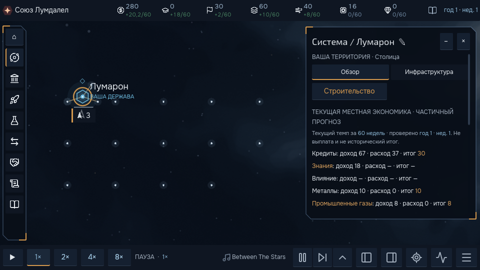
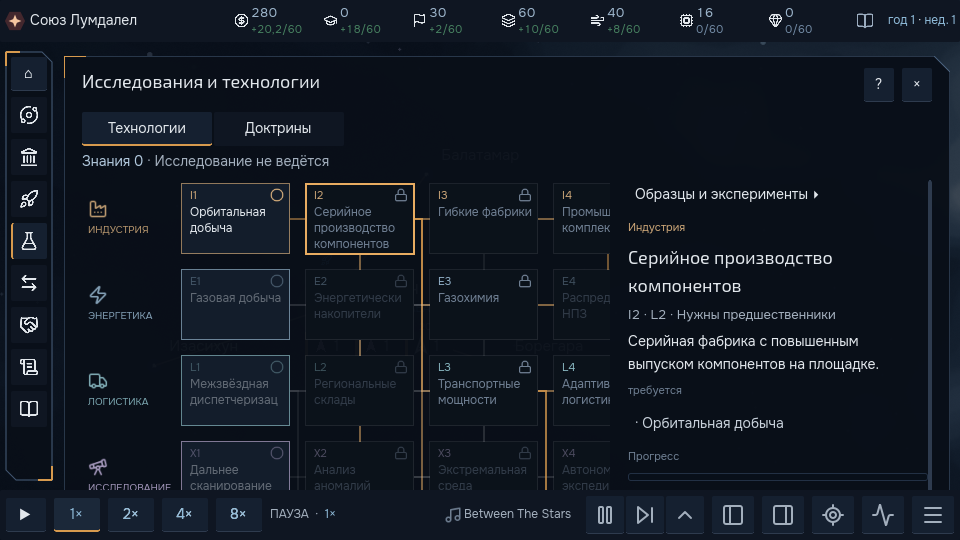

# Concordance

Concordance is a single-player space 4X strategy game. Survey nearby systems, build settlements and supply routes, and negotiate, trade or fight with rival powers. The alpha is available in English and Russian.

**[Download the alpha](https://github.com/Aamoree99/concordance-releases/releases)** · **[Report a bug](https://github.com/Aamoree99/concordance-releases/issues/new/choose)**

| Platform | Pick the matching release asset | Launch |
| --- | --- | --- |
| Windows on Intel or AMD | `CONCORDANCE-Windows-x86_64.zip` | Extract the entire ZIP and open `CONCORDANCE.exe`. |
| Windows on ARM | `CONCORDANCE-Windows-arm64.zip` | Extract the entire ZIP and open `CONCORDANCE.exe`. |
| Linux on Intel or AMD | `CONCORDANCE-Linux-x86_64.tar.gz` | Extract the archive and run `./CONCORDANCE.x86_64` from the extracted directory. |
| Linux on ARM | `CONCORDANCE-Linux-arm64.tar.gz` | Extract the archive and run `./CONCORDANCE.arm64` from the extracted directory. |
| macOS on Intel or Apple silicon | `CONCORDANCE-macOS-universal.dmg` | Open the disk image and drag Concordance to Applications. |

All builds are 64-bit. Windows and Linux builds need the accompanying game data and runtime directories in place. The first public alpha is experimental. See each release for verification status and known issues.

## По-русски

Concordance — одиночная космическая 4X-стратегия. Разведывай системы, строй поселения и линии снабжения, торгуй, договаривайся или воюй с другими державами. В альфе доступны русский и английский.

[Скачать сборку](https://github.com/Aamoree99/concordance-releases/releases) можно в разделе **Assets**. Распакуй архив целиком и запусти игру по инструкции выше. Для macOS открой DMG и перенеси Concordance в «Программы». Об ошибках можно написать в [Issues](https://github.com/Aamoree99/concordance-releases/issues/new/choose).

[Third-party notices and licenses](THIRD_PARTY_NOTICES.md)
